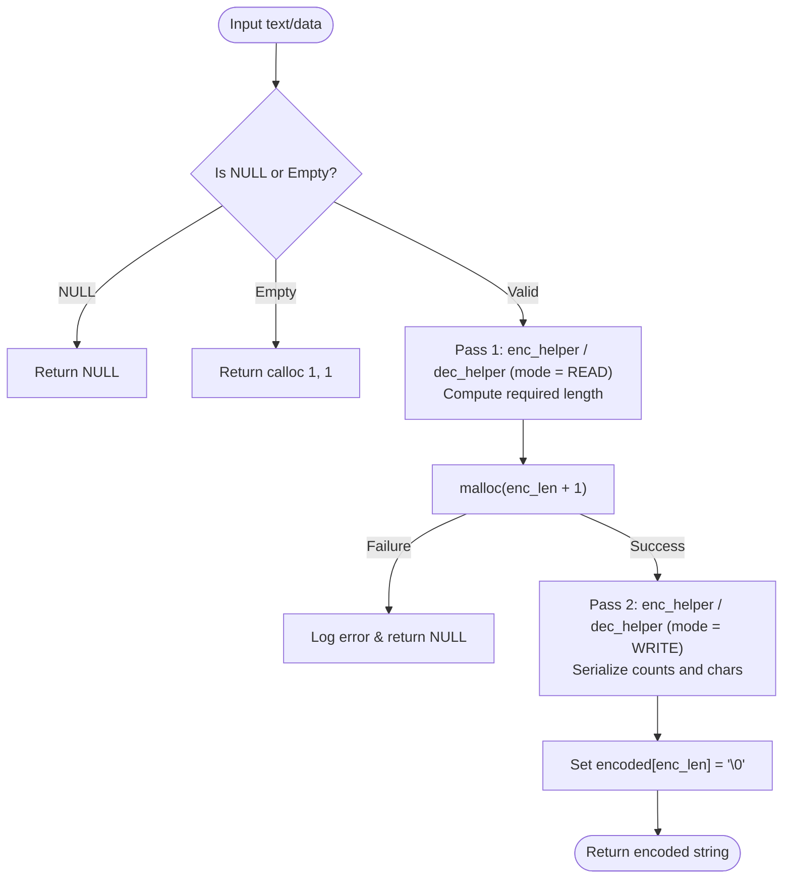
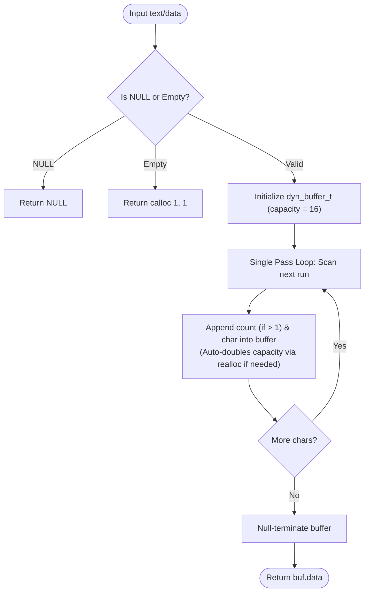

# Run-Length Encoding Maintenance & Implementation Comparison

## Overview

This document provides a comparative study of implementation techniques for `exercises/practice/run-length-encoding` in C:
1. **Approach 1 (Reference Technique)**: Two-Pass Scan with Exact Allocation via Unified Dual-Mode State Machine (`READ`/`WRITE` flag, `log10` digit sizing). Pinned reference: `exercises/practice/run-length-encoding/.meta/example.c#L10`.
2. **Approach 2 (Alternative Technique)**: Single-Pass Streaming Dynamic Buffer Accumulator (Dynamic StringBuilder with geometric capacity growth, integer formatting, zero `<math.h>` dependency). Experimental source: `work/R48-T046/dynamic_buffer_rle.c`.

Both implementations strictly adhere to the contract defined in `run_length_encoding.h`:
- `char *encode(const char *text);`
- `char *decode(const char *data);`

---

## Architectural Comparison Matrix

| Metric / Dimension | Approach 1: Two-Pass Exact Sizing (Reference) | Approach 2: Streaming Dynamic Buffer (Alternative) |
| :--- | :--- | :--- |
| **Primary Abstraction** | Raw string pointer traversal, dual-mode enum (`READ`/`WRITE`) | Dynamic capacity buffer struct (`dyn_buffer_t`) |
| **Input Iterations** | **2 passes** (Pass 1: compute length, Pass 2: format & copy) | **1 pass** (Processes characters sequentially in a stream) |
| **Heap Allocations** | Exactly 1 `malloc` per call (allocated to exact length + 1) | Initial allocation (16 B) + amortized geometric `realloc` |
| **Peak Memory Footprint**| Optimal ($O(M)$ where $M$ is output string length) | Amortized $O(M)$ (temporary capacity up to $2M$ before finalization) |
| **Mathematical Dependencies**| `<math.h>` `log10` for digit counting (requires linking `-lm`) | Pure integer arithmetic / `snprintf` (no `-lm` required) |
| **Streaming Feasibility** | Incompatible with streams (requires rewinding/double scanning) | Compatible with single-pass streams and pipe buffers |
| **Branching / Complexity** | Inner loops branch on `mode == WRITE` | Unidirectional sequential flow with isolated buffer append |
| **Safety / Error Handling**| Returns `NULL` on memory allocation failure | Cleans up intermediate buffer and returns `NULL` on `realloc` failure |

---

## Control Flow Breakdown

### Approach 1: Two-Pass Exact Sizing (`.meta/example.c`)

- **Pass 1**: Evaluates runs. When `count > 1`, calls `count_digits(count) = log10(count) + 1` to compute digit widths. Sums digit widths and character occurrences.
- **Allocation**: Directly allocates `enc_len + 1` bytes. No wasted bytes and no reallocations.
- **Pass 2**: Traverses the input string a second time. When `count > 1`, formats the count via `snprintf(encoded, cdigits + 1, "%zu", count)`. Copies the character byte.
- **Decode**: Pass 1 scans digits and characters to sum output length; allocates `dec_len + 1`; Pass 2 scans digits, parses integer counts, and writes repeated characters.

### Approach 2: Streaming Dynamic Buffer (`work/R48-T046/dynamic_buffer_rle.c`)

- **Dynamic Buffer**: Managed by `dyn_buffer_t { char *data; size_t len; size_t cap; }`.
- **Single Pass**: Evaluates consecutive character runs in one iteration. Formats counts using local stack buffers into the dynamic accumulator.
- **Geometric Resizing**: Doubles capacity whenever `len + additional + 1 > cap`.
- **Decode Flow**: Scans input once: accumulates digits into integer count `count = count * 10 + (*p - '0')`. Appends the character repeated `count` times (or 1 time if no count was present) directly into the buffer.

---

## Canonical Cases Agreement

Both implementations were tested against all 13 canonical test cases specified in `.meta/tests.toml` and `test_run_length_encoding.c`:

1. `ad53b61b-6ffc-422f-81a6-61f7df92a231` (encode empty string `""` $\rightarrow$ `""`)
2. `52012823-b7e6-4277-893c-5b96d42f82de` (encode single characters `"XYZ"` $\rightarrow$ `"XYZ"`)
3. `b7868492-7e3a-415f-8da3-d88f51f80409` (encode uniform repeated runs `"AABBBCCCC"` $\rightarrow$ `"2A3B4C"`)
4. `859b822b-6e9f-44d6-9c46-6091ee6ae358` (encode mixed runs `"WWWWWWWWWWWWBWWWWWWWWWWWWBBBWWWWWWWWWWWWWWWWWWWWWWWWB"` $\rightarrow$ `"12WB12W3B24WB"`)
5. `1b34de62-e152-47be-bc88-469746df63b3` (encode multiple whitespace `"  hsqq qww  "` $\rightarrow$ `"2 hs2q q2w2 "`)
6. `abf176e2-3fbd-40ad-bb2f-2dd6d4df721a` (encode lowercase characters `"aabbbcccc"` $\rightarrow$ `"2a3b4c"`)
7. `7ec5c390-f03c-4acf-ac29-5f65861cdeb5` (decode empty string `""` $\rightarrow$ `""`)
8. `ad23f455-1ac2-4b0e-87d0-b85b10696098` (decode single characters `"XYZ"` $\rightarrow$ `"XYZ"`)
9. `21e37583-5a20-4a0e-826c-3dee2c375f54` (decode uniform repeated runs `"2A3B4C"` $\rightarrow$ `"AABBBCCCC"`)
10. `1389ad09-c3a8-4813-9324-99363fba429c` (decode mixed runs `"12WB12W3B24WB"` $\rightarrow$ `"WWWWWWWWWWWWBWWWWWWWWWWWWBBBWWWWWWWWWWWWWWWWWWWWWWWWB"`)
11. `3f8e3c51-6aca-4670-b86c-a213bf4706b0` (decode whitespace `"2 hs2q q2w2 "` $\rightarrow$ `"  hsqq qww  "`)
12. `29f721de-9aad-435f-ba37-7662df4fb551` (decode lowercase characters `"2a3b4c"` $\rightarrow$ `"aabbbcccc"`)
13. `2a762efd-8695-4e04-b0d6-9736899fbc16` (consistency roundtrip: decode(encode(`"zzz ZZ  zZ"`)) $\rightarrow$ `"zzz ZZ  zZ"`)

Both approaches pass all 13 canonical tests with 0 failures, 0 ignored, and 0 memory leaks under AddressSanitizer.

---

## When to Use Which Approach

- **Choose Approach 1 (Two-Pass Exact Sizing)** when memory is extremely constrained (e.g. deeply embedded systems) and minimizing heap allocations to the absolute byte-exact minimum is critical.
- **Choose Approach 2 (Streaming Dynamic Buffer)** for general-purpose systems, network protocols, file streaming, or large datasets where scanning the input string twice introduces latency, or where input cannot be easily rewound.
